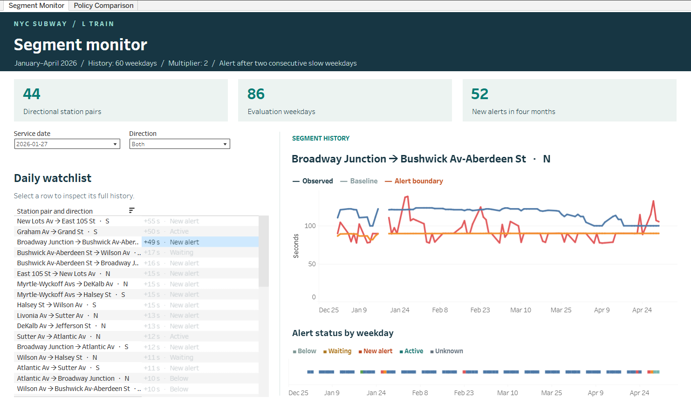
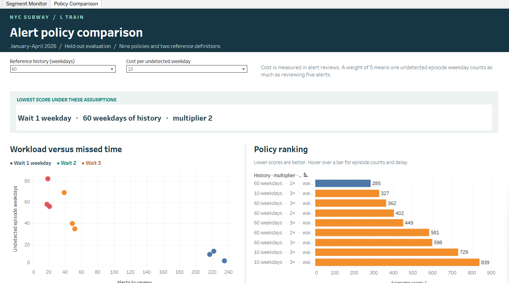

Insert some screenshots of the tableay dashboareds and maybe code at the top later

# NYC L Train Bottleneck Monitor

The Question: Where do L trains repeatedly run slower than usual, and when should a transit analyst investigate?

To answer this question I built a PostgreSQL and Python workflow to identify sustained slowdowns, compare alert policies, and present the results in two interactive Tableau dashboards. The goal is to help an operations team prioritize investigations while understanding the consequences/tradeoffs of fewer alerts.

[View Dashboards](https://public.tableau.com/app/profile/jonathan.dinh6231/viz/LTrainOperations/PolicyComparison)

# Dashboard preview

**Segment Monitor** — select a station pair to investigate its travel time history and alert status.

**Policy Comparison** — compare investigation workload and detection performance under different cost assumptions.

## Data and evaluation design

The source contains daily travel times between station pairs, measured separately in each direction(North/South). Travel time includes the stop at the second station.

I imported **1.67 million subway records across 67 months** from TransitLab’s analysis of MTA data. From this dataset, I selected **44 directional L train station pairs** with at least 95% usable weekday data during 2025.

The analysis uses three periods.

| Period | Purpose |
|---|---|
| September–December 2024 | Supplies historical observations for the first rolling baselines |
| January–December 2025 | Develops and compares candidate alert rules |
| January–April 2026 | Evaluates the same candidate rules on later data reserved from development |

The evaluation covers **86 weekdays and 3,784 segment observations**

Source and license are available through [TransitLab](https://docs.transitlab.nyc/datasets/subway-segment-times/) and [CC BY 4.0](https://docs.transitlab.nyc/start/license/).

## How a slow day becomes an alert
For each segment, I calculate

    Baseline = median of usable travel times over the previous W weekdays
    MAD = median absolute distance from that baseline
    Threshold = max(10 seconds, multiplier × 1.4826 × MAD) So either 10 seconds or multiplier, whichever is larger
    Alert boundary = baseline + threshold

A day receives a slow flag when its travel time reaches or exceeds the alert boundary.

The 10 second floor requires a minimum absolute increase. Both the floor and multiplier are analytical settings that an operator could revisit.

The final policy comparison uses:

| Historical window | Variability multiplier | Required consecutive slow weekdays to be flagged |
|---|---:|---|
| 10 weekdays | 3 | 1, 2, or 3 |
| 60 weekdays | 3 | 1, 2, or 3 |
| 60 weekdays | 2 | 1, 2, or 3 |

A qualifying streak produces one new alert. The alert remains active through the final slow weekday. A normal or unknown weekday will break the streak.

## What counts as a reference episode?

A reference slow day has a travel time at least **10 seconds above its historical median**.

A reference episode requires **at least five reference slow days within seven weekdays**, with known information for all seven days. Overlapping intervals can be merged, with boundaries at their first and last slow dates. An episode can therefore last several weeks and contain some normal weekdays.

## Analysis workflow

### 1. Validate the source in PostgreSQL

`sql/01_validate_source.sql` checks the imported table for date coverage, duplicate keys, missing identifiers, unusable travel times, unexpected weekends, train counts, and identical start and end stops.

`sql/02_reproduce_segment_baseline.sql` reproduces an initial browser query for Union Square -> 3 Av using the local PostgreSQL data.

### 2. Select reliable L train segments

`sql/03_profile_l_train_coverage.sql` filters the source to the L route and compares each directional pair against the expected 2025 weekday calendar.

A pair qualifies when at least 95% of expected weekdays have a positive travel time. This selects the 44 monitored pairs using development data.

### 3. Calculate historical baselines in SQL

`sql/05_calculate_baselines.sql` uses window functions to collect the previous 10, 20, and 60 weekdays for each pair.

It calculates the historical median and median absolute deviation, excludes the current day, and requires at least 80% usable history.

`sql/06_inspect_baseline_candidates.sql` compares slow day counts, segment rankings, disagreements between windows, and how often historical variability determines the threshold.

### 4. Investigate the baselines in Python

`notebooks/01_baseline_investigation.ipynb` connects directly to PostgreSQL through SQLAlchemy and psycopg, loads query results into pandas, and plots them with Matplotlib.

I examined Broadway Junction → Bushwick Av–Aberdeen St and East 105 St → New Lots Av to understand why different historical windows produce different alerts.

I also test **18 combinations** of history length, minimum increase, and variability multiplier to measure how sensitive slow day counts are to those choices.

### 5. Define sustained episodes and backtest policies in SQL

`sql/07_label_slowdown_episodes.sql` defines retrospective reference episodes and merges overlapping qualifying intervals.

`sql/08_backtest_alert_policies.sql` identifies consecutive slow weekday streaks, generates one alert per qualifying streak, and measures whether active alerts overlap reference episodes.

It compares **nine policies**

### 6. Verify and evaluate the policies in Python

`notebooks/02_alert_evaluation.ipynb` independently reproduces the SQL episodes, alert records, and episode assessments. It then compares alternative episode definitions, measures additional delay on the same detected episodes, and applies the same nine policies to January–April 2026.

The notebook estimates investigation workload, tests cost assumptions, and exports the evaluation tables to CSV.

### 7. Present the findings in Tableau

`sql/sql/09_dashboard_exports.sql` prepares daily evaluation data for the dashboard’s default policy using 60 weekdays of history, multiplier 2, and two consecutive slow weekdays.

I exported this view alongside the notebook’s policy results. The Tableau workbook packages the data into two interactive dashboards for segment investigation and policy comparison.

## Reproducing the analysis

1. Download the 67 monthly Parquet files covering April 2021–October 2026
   from TransitLab and import them into `public.subway_segment_times`
   in PostgreSQL.
2. Run SQL files `01` through `08` in numerical order, including their
   setup statements before running verification queries.
3. Configure the notebooks’ PostgreSQL connection, then run
   `01_baseline_investigation.ipynb` followed by `02_alert_evaluation.ipynb`.
4. Run `09_dashboard_exports.sql` and save dashboard CSVs in `data/exports/`.
5. Open the workbook in `tableau/`, reconnect its CSV sources if needed,
   or view the published dashboards linked above.

Requires PostgreSQL, Jupyter, pandas, NumPy, Matplotlib, SQLAlchemy,
and psycopg. Keep database credentials out of committed files.

## Deliberate analytical choices

**Challenged the initial baseline.** The initial AI(Codex) suggestion only using 10 weekdays. I questioned whether an unusually fast or slow stretch could distort the baseline and recommended testing longer windows. This led to comparing 10, 20, and 60 weekdays and extending the warmup to September 2024.

In a June example, recent variability raised a short window’s alert boundary enough to stop flagging elevated travel times, while the 60 weekday candidate continued flagging them. I investigated both the baseline and the variability allowance to explain the disagreement.

**Preserved unknown observations.** Explicit weekday rows prevent gaps from joining separate slow readings into a streak.

**Reserved later data.** Development uses 2025, followed by evaluation on January–April 2026 using the same candidate policies.

**Checked the reference definition.** The development data contains 21 episodes under the 60 weekday reference and 14 under the 20 weekday reference. Evaluation contains 14 and 13 respectively. This sensitivity affects how detection results should be interpreted.

**Verified across implementations.** Python reproduced all **21 original SQL development episodes, 189 episode assessments, and 1,937 development alerts**.

**Compared delay on matching episodes.** Paired comparisons measure the additional delay for episodes detected by both policies, avoiding changes caused by comparing different groups of episodes.

## Evaluation metrics

| Metric | Meaning |
|---|---|
| New alerts | Potential investigations generated, counted once per qualifying streak |
| Detected episodes | Reference episodes overlapping an active alert |
| Missed episodes | Reference episodes without an overlapping active alert |
| Detection delay | Weekdays from episode onset to first detection |
| Additional detection delay | Difference between policies for episodes both detect |
| Undetected episode weekdays | Delay before detection plus the full observed duration of missed episodes |
| Estimated review hours | Alerts multiplied by an assumed five minutes per review |

## Main results

The following evaluation policies use **60 weekdays of detector history and multiplier 2**.

| Metric | Alert after one slow weekday | Alert after two slow weekdays |
|---|---:|---:|
| New alerts | 235 | 52 |
| Detected episodes, 60 weekday reference | 14 / 14 | 13 / 14 |
| Detected episodes, 20 weekday reference | 12 / 13 | 11 / 13 |
| Undetected episode weekdays, 60 weekday reference | 5 | 35 |
| Estimated review hours | 19.58 | 4.33 |

Requiring a second slow weekday reduces simulated alerts by **78%**, removing **183 potential reviews**. Under the five minute assumption, this represents **15.25 potential review hours saved**.

It also misses one additional episode under each reference definition. Among episodes both policies detect, the additional delay has a median of **one weekday** and a maximum of **four weekdays**.

## Business decision and cost sensitivity

A team’s preferred policy depends on its review capacity and the importance assigned to undetected slowdowns.

I test the following score

    Scenario score = alerts + cost weight × undetected episode weekdays. One alert costs one review unit. A weight of 5 values one undetected episode weekday at five alert reviews. Across the nine policies, two reference definitions, and five cost weights, the evaluation produces **90 scenarios**. At weight 5, the policy using 60 weekdays, multiplier 2, and two consecutive slow weekdays has the lowest evaluation score under both reference definitions. At weights 10, 25, and 50, the same detector with alerts after one slow weekday has the lowest score. The dashboard therefore presents a conditional recommendation that changes with operational priorities.

### Segment Monitor (Tableau Dashboard)

Select a date and direction to inspect station pairs ranked by additional travel time. Clicking a pair displays its full travel time history, historical baseline, alert boundary, and weekday alert status.

This helps an analyst identify where a slowdown occurred, inspect its persistence, and prioritize follow-up.

## Interpretation and limitations

The demonstrated outcome is historical policy performance and estimated investigation workload. Actual review savings and service improvements would require an operational pilot.

Reference episodes are constructed from travel times and share data with the detectors. External incident and maintenance records would strengthen validation. Alerts outside the reference episodes can still warrant investigation.

The evaluation contains 13 or 14 episodes depending on the definition, so detection percentages are sensitive to individual episodes. Reference windows also require complete observations and sufficient remaining data at the end of the evaluation period.

Daily aggregates support investigation prioritization. Establishing causes, passenger impact, and the effects of corrective action requires additional operational evidence.